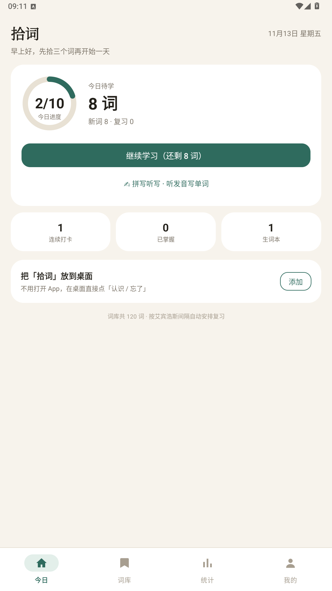
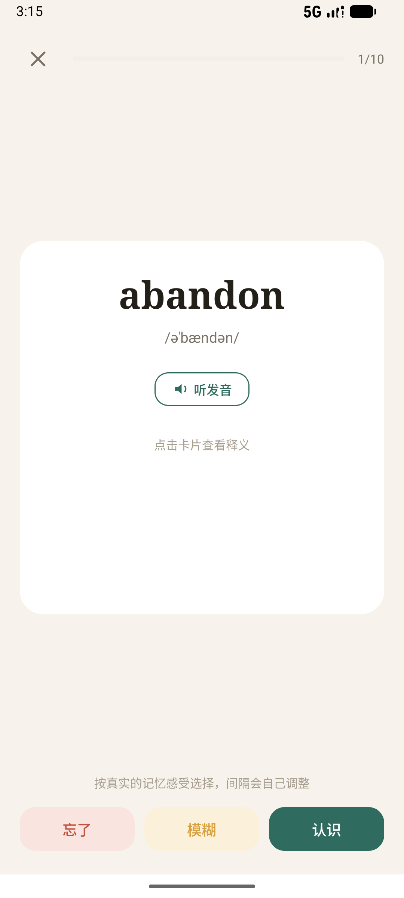
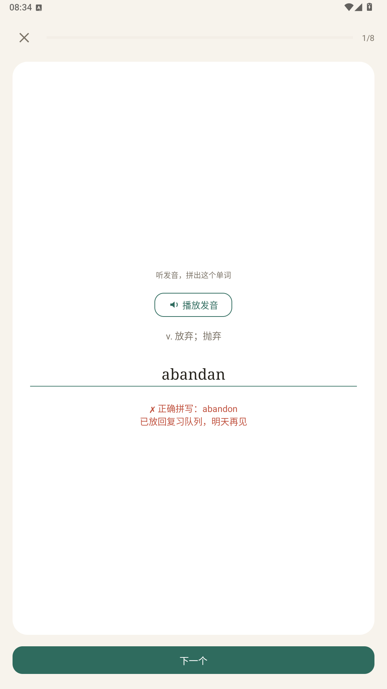
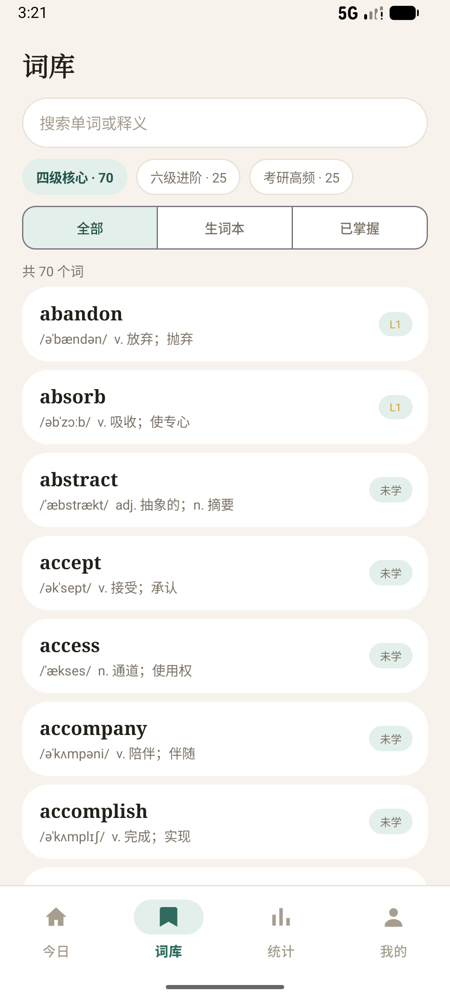
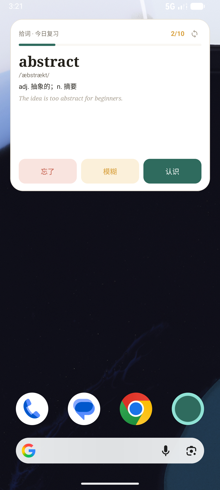
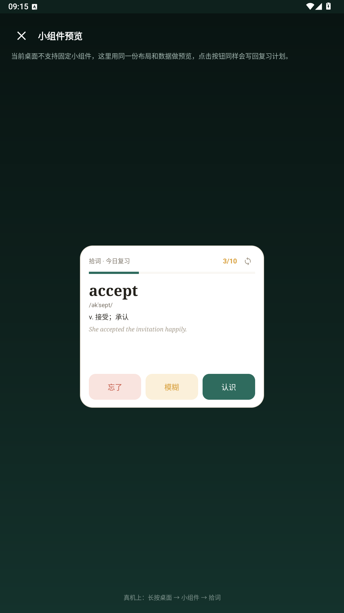

# 拾词 · Shici

> 单词记忆（B4）主 App + P1 可交互桌面小组件
> 课程：Android 应用开发 · 作者：刘浩洋

**拾词**是一个纯本地的背单词 App：按艾宾浩斯间隔安排复习，把「今天该记的词」送到卡片上，也送到手机桌面。

---

## 一、为什么是「桌面小组件」

单词类 App 最大的问题是：**要打开 App 才会想起来背**。

所以这个项目把小组件当成**主入口**而不是装饰：

- 桌面直接显示今天要复习的词；
- 点「忘了 / 模糊 / 认识」就能完成一次复习，**不启动 Activity**，评分直接写回本地数据库；
- 进度条颜色随完成度变化（红 → 琥珀 → 绿），不复习就一直红着；
- 每天 0 点后自动换一批词。

技术上对应 `AppWidgetProvider` + `RemoteViews` + `PendingIntent` 广播 + `BroadcastReceiver.goAsync()` + Room。

> 模拟器提示：雷电自带的 Launcher3 是删减版，没有组件选择器，`requestPinAppWidget` 也返回不支持。
> 这种情况下首页的「添加」按钮会变成「预览」，进入 `WidgetPreviewActivity` ——
> 它复用**同一份 `widget_word.xml` 布局**和同一套数据逻辑，点按钮同样会写回复习计划。
> 在 Pixel 启动器 / 真机上，则是真正钉到桌面的小组件。

---

## 二、界面

| 首页 | 卡片学习 |
| --- | --- |
|  |  |

| 拼写听写 | 词库 |
| --- | --- |
|  |  |

| 桌面小组件（Pixel 启动器实测） | 小组件预览（桌面无组件选择器时） |
| --- | --- |
|  |  |

## 三、功能清单

| 类型 | 功能 |
| --- | --- |
| 必做 ① | **词库分级管理**：内置四级 / 六级 / 考研三本词书，支持按词书浏览、关键词搜索、生词本与已掌握筛选 |
| 必做 ② | **艾宾浩斯复习调度**：三档反馈（忘了 / 模糊 / 认识）→ Leitner 记忆盒 1~7 级 → 自动计算下次复习时间；每日「先复习、再学新词」 |
| 自选 | **拼写听写模式**：TTS 发音 + 听音拼写 + 写错立即回炉重排；结果会写回复习算法 |
| 伴生 P1 | **可交互桌面小组件**：4×3 详细版 + 2×2 迷你版，桌面直接评分并刷新 |

已实现：首页今日任务、卡片学习流（翻转 + TTS 发音）、拼写听写、词库浏览与搜索、统计（7 日柱状图 / 正确率 / 连续打卡）、设置（每日新词、演示加速、自动发音、重置进度）。

---

## 四、复习算法

简化版 Leitner：

```
忘了 → box = 1
模糊 → box = max(1, box)
认识 → box = min(7, box + 1)

间隔（天）：box 1→1, 2→2, 3→4, 4→7, 5→15, 6→30, 7→60
下次复习 = 现在 + 间隔
```

- `box >= 5` 视为「已掌握」；
- `box` 在 1~3 的词记为「易忘」，可在统计页看到；
- 设置里的 **演示加速** 会把「天」换成「分钟」，答辩现场可以立刻看到间隔变化。

---

## 五、技术栈

- **Kotlin** + XML View（ViewBinding）
- **Room**：`book` / `word` / `review_log` 三张表
- **WorkManager**：每天 00:05 刷新小组件
- **AppWidget**：`RemoteViews` + 广播回写
- **Coroutines / Lifecycle**：异步查询与 UI 更新
- **TextToSpeech**：单词发音
- 单 Activity + 4 个 Fragment，MVVM 的轻量版（Fragment → Repository → DAO）

最低支持 Android 8.0（API 26），编译 SDK 34。

---

## 六、运行

```bash
# 需 JDK 17+ 与 Android SDK 34
./gradlew assembleDebug
adb install -r app/build/outputs/apk/debug/app-debug.apk
```

首次启动会自动从 `app/src/main/res/assets/words.json` 导入 120 个词（三级词书）。

---

## 七、目录结构

```
app/src/main/java/com/shici/app/
├── App.kt                     Application：初始化词库、调度小组件
├── data/
│   ├── Entities.kt            Book / Word / ReviewLog
│   ├── Daos.kt                查询与更新
│   ├── AppDatabase.kt         Room 数据库
│   ├── Srs.kt                 Leitner 复习算法
│   ├── Settings.kt            SharedPreferences 设置
│   └── WordRepository.kt      数据仓库（今日任务、队列、统计）
├── ui/
│   ├── MainActivity.kt        底部导航
│   ├── home/                  今日 / 进度环 / 添加小组件
│   ├── study/                 卡片学习流（翻转 + 发音 + 评分）
│   ├── words/                 词库浏览 / 搜索 / 生词本
│   ├── stats/                 统计与图表
│   ├── settings/              设置
│   └── views/                 RingView 进度环、BarChartView 柱状图
└── widget/
    ├── WidgetUpdater.kt       渲染小组件、PendingIntent、每日刷新
    └── WidgetProviders.kt     4×3 / 2×2 两个 Provider + Worker
```

---

## 八、后续计划

- [x] 拼写听写模式（自选功能）
- [ ] 词库导入（CSV / JSON）
- [ ] 小组件集合视图（`RemoteViewsService`，桌面可滚动刷词）
- [ ] 打卡日历热力图

## 九、词库来源

内置词条为课程演示用示例数据，释义参考通用词典整理，例句为自写例句。
